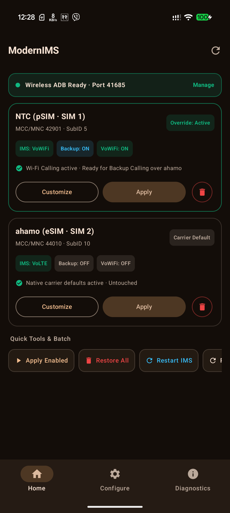
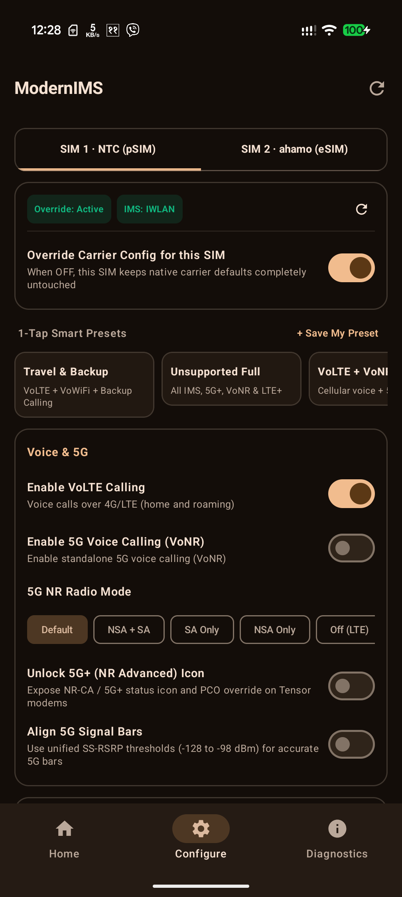
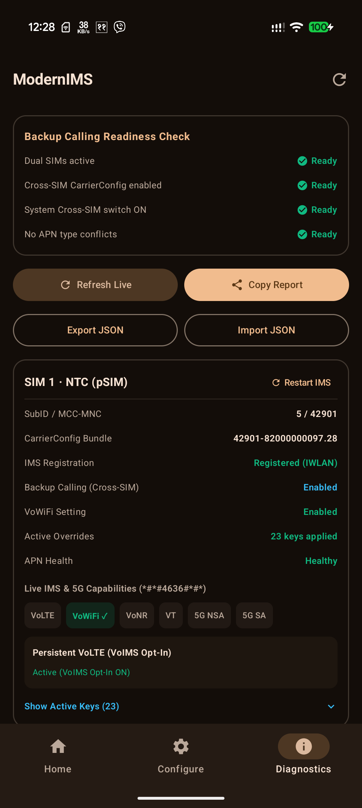

# ModernIMS

> **Rootless Material You IMS & 5G toolkit for Google Pixel (Android 10–17): per-SIM VoLTE, VoWiFi, working Backup Calling (Cross-SIM), Experimental Persistent VoLTE, 5G SA/NSA/5G+ tuning, Live Capability Diagnostics, Captive Portal fix, and 1-tap Quick Settings re-apply.**

[](https://developer.android.com)
[](https://developer.android.com)
[](https://m3.material.io)
[](https://github.com/bipinsubedi/ModernIMS/releases)
[](https://apps.obtainium.imranr.dev/redirect.html?r=obtainium://add/https://github.com/bipinsubedi/ModernIMS)
[](LICENSE)

---

## Screenshots

<p align="center">
  
  &nbsp;
  
  &nbsp;
  
</p>

*(Captured live on a Google Pixel 9 Pro XL running Android 17 with Dual-SIM NTC pSIM + ahamo eSIM.)*

---

## Why ModernIMS?

Originally forked from [`svenuks/ImsForPixel`](https://github.com/svenuks/ImsForPixel) and inspired by advanced Tensor diagnostics in [`Pixel-Tailor-CN/TensorIMS`](https://github.com/Pixel-Tailor-CN/TensorIMS), **ModernIMS** fixes the dual-SIM and Android 14–17 regressions that break classic Pixel IMS and earlier utilities:

| Capability | Classic Pixel IMS | Original `ImsForPixel` | **ModernIMS (v2.2.0)** |
|---|---|---|---|
| **Root / Shizuku Required** | ⚠️ Requires Shizuku | ❌ Standalone | ❌ **Standalone (Built-in Wireless ADB pairing)** |
| **Per-SIM Isolation** | ⚠️ Manual per-SIM | ❌ Overwrites & resets **both** SIMs | ✅ **True Per-SIM Master Switch & Non-Destructive Bundles** |
| **Backup Calling (Cross-SIM)** | ⚠️ CarrierConfig only (broken on Android 14+) | ❌ Hardcoded OFF | ✅ **CarrierConfig + `ImsMmTelManager` + 4-Point Readiness Check** |
| **APN Conflict Detection** | ❌ None | ❌ None | ✅ **Detects & 1-tap fixes `apn=internet` `,ims` ePDG ERR 24 loops** |
| **Live `*#*#4636#*#*` Matrix** | ❌ None | ⚠️ Basic boolean | ✅ **Real Transport (`VoWiFi`/`CROSS_SIM`/`NR`/`LTE`) + 6-Capability Matrix** |
| **5G Radio & 5G+ Tuning** | ⚠️ Basic 5G toggle | ❌ Basic boolean | ✅ **NSA+SA / SA Only / NSA Only / Pure LTE + 5G+ Icon & RSRP Bars** |
| **Persistent VoLTE (VoIMS Opt-In)** | ❌ None | ❌ None | ✅ **Atomic VoIMS Opt-In + ICCID-Safe Rollback Backup** |
| **Post-Reboot Re-Apply** | ⚠️ Shizuku needed | ❌ Manual every reboot | ✅ **Quick Settings Tile + 90s Auto-Apply Watcher + Boot Actions + Auto-Launch Apply** |
| **Banking-App Friendly** | ⚠️ Manual toggle | ⚠️ Leaves Debug ON | ✅ **Optional Auto-Disable Wireless Debugging after apply** |
| **Presets, Profiles & Tools** | ❌ None | ❌ None | ✅ **5 Smart Presets + Save ★ My Preset + Custom Key Editor + JSON + Captive Portal Fix** |

---

## Key Features

### 1. True Per-SIM Isolation (Never Clobber Your Working SIM)
Running a dual-SIM setup where **SIM 1** needs overrides (e.g., roaming SIM in an unsupported country) while **SIM 2** already works natively (e.g., NTT docomo / ahamo, SoftBank, Verizon, T-Mobile)?
- Each SIM has an independent **Override Carrier Config** master switch (default **OFF**).
- Untouched SIMs are **never** modified and **never** hit with `TelephonyManager.resetIms()`.
- **Non-destructive bundles:** Toggling a feature OFF omits its keys rather than writing `false`, and applying always clears stale merged overrides first.

### 2. Real Backup Calling (Cross-SIM IMS) on Android 14–17
On Pixel devices (Pixel 6–10 series), Google hides the Backup Calling toggle for unsupported carriers and `CarrierConfigManager` alone does not activate it:
- **ModernIMS** injects `carrier_cross_sim_ims_available_bool` + `enable_cross_sim_calling_on_opportunistic_data_bool` **and** invokes `ImsMmTelManager.setCrossSimCallingEnabled(true)` under shell permission identity.
- **4-Point Backup Calling Readiness Check:** Verifies Dual-SIM state, Cross-SIM CarrierConfig, System `crossSimCallingEnabled`, and APN Health in **Diagnostics**.
- **Built-in APN Health Inspector:** Detects when a non-IMS APN (such as `apn=internet` with `type=default,supl,ims`) causes ePDG IKEv2 `ERR 24` auth failures, and provides a **1-tap Fix APN** action.

### 3. Live IMS & 5G Capability Matrix + Persistent VoLTE (v2.2.0)
- **Live Capabilities (`*#*#4636#*#*`):** Per-SIM availability badges for `VoLTE`, `VoWiFi`, `VoNR`, `VT`, `5G NSA`, and `5G SA`, plus **1-Tap Restart IMS** (on Home & Diagnostics).
- **5G NR Mode, 5G+ Icon & Signal Bars:** Granular `Default` / `NSA + SA` / `SA Only` / `NSA Only` / `Off (Pure LTE)` radio selector, NR-Advanced (`5G+`) bandwidth/band/PCO unlock keys, unified SS-RSRP 5G signal thresholds (`-128` to `-98 dBm`), and **Always Show Data RAT Icon**.
- **Persistent VoLTE (`ProvisioningManager.KEY_VOIMS_OPT_IN_STATUS`):** Per-SIM opt-in toggle with an atomic SHA-256 ICCID-verified backup (`noBackupFilesDir`) so you can **Restore Original** carrier provisioning safely at any time.
- **Captive Portal Probe Override:** Fix "Connected, no internet" warnings on travel or restrictive Wi-Fi networks with 1-tap `Cloudflare`, `Xiaomi CN`, `Huawei CN`, or `Reset Default` (`DELETE_global`).

### 4. Zero-Friction Post-Reboot Recovery
Android 16/17 blocks non-system apps from using `overrideConfig(..., persistent = true)` (causing `com.android.phone` crashes), so temporary CarrierConfig overrides reset on reboot. **ModernIMS** makes recovery effortless:
- **Quick Settings Tile:** Add **ModernIMS** to your notification shade. After a reboot, tap the tile — it starts a 90-second **Auto-Apply Watcher** and opens Wireless Debugging so flipping one switch re-applies everything automatically.
- **Boot Notification Actions:** Tap **Quick Re-Apply** or **Auto-Apply Watcher** directly from the post-reboot notification.
- **Auto-Apply on Launch:** Opening ModernIMS when Wireless Debugging is active automatically re-applies your saved overrides after a reboot.
- **Auto-Disable Wireless Debugging (Optional):** Automatically turns Wireless Debugging OFF right after overrides are applied — ideal for banking apps.

### 5. Smart Presets, Custom Keys & Profile Backup
- **1-Tap Smart Presets + `★ My Preset`:** Choose from `Travel & Backup`, `Unsupported Full`, `VoLTE + VoNR`, `Pure LTE (Battery)`, `Minimal VoLTE`, or save your own **★ My Preset**.
- **Custom CarrierConfig Key Editor:** Inject any `bool`, `int`, or `string` `CarrierConfigManager` key directly from Advanced Settings.
- **JSON Profile Export/Import & Markdown Report:** Back up your dual-SIM configuration or copy a full diagnostic snapshot in one tap.

---

## Quick Start

1. **Install ModernIMS:** Download the latest `ModernIMS-v*.apk` from [GitHub Releases](https://github.com/bipinsubedi/ModernIMS/releases).
2. **Pair Once:** Connect to Wi-Fi, tap the **Wireless ADB** pill at the top of **Home** → **Open Wireless Debugging** → **Pair device with pairing code**, and enter the 6-digit code in the notification.
3. **Configure Your SIM(s):** Go to **Configure**, select SIM 1 or SIM 2, pick a **Smart Preset** (or customize toggles), and tap **Apply**.
4. **Add the Quick Settings Tile (Recommended):** Pull down Quick Settings → Edit → drag **ModernIMS** into your active tiles for 1-tap re-apply after reboots.

---

## Building from Source

```bash
git clone https://github.com/bipinsubedi/ModernIMS.git
cd ModernIMS

# JDK 17 and Android SDK (compileSdk 36) required
./gradlew assembleDebug    # app/build/outputs/apk/debug/app-debug.apk
./gradlew assembleRelease  # app/build/outputs/apk/release/app-release.apk
```

---

## Credits & License

- **Maintainer:** [Bipin Subedi](https://github.com/bipinsubedi)
- **Upstream Base:** [`svenuks/ImsForPixel`](https://github.com/svenuks/ImsForPixel)
- **Feature Inspiration:** [`Pixel-Tailor-CN/TensorIMS`](https://github.com/Pixel-Tailor-CN/TensorIMS) (Persistent VoLTE VoIMS opt-in pattern, 5G NR mode & 5G+ icon config, Captive Portal probe management, and `*#*#4636#*#*` capability inspection)
- **Libraries:** [Kadb](https://github.com/flyfishxu/Kadb), [LSPosed HiddenApiBypass](https://github.com/LSPosed/AndroidHiddenApiBypass)
- Licensed under the [MIT License](LICENSE).
